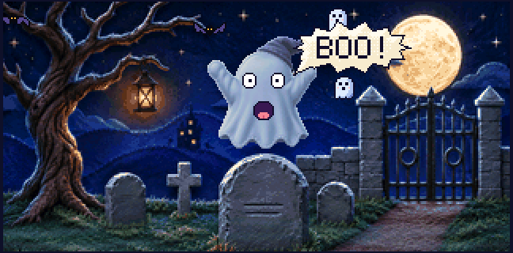

# Ghost Note

吉他音符后面跟着一道人声。可以让它唱同音，也可以往上叠八度，再加一点暗色混响。

## 配套音频包

先安装音频包，再安装 App。

- Ghost Voice `org.resona.creative.ghost-note.voice` 1.0.0

## 两个编码器

| 页面／模式 | 上方旋转 | 上方短按 | 上方长按 | 下方旋转 | 下方短按 | 下方长按／按住 |
| --- | --- | --- | --- | --- | --- | --- |
| Ghost Note | 调幽灵歌声的音量 | 歌声音程：同音／高八度／高八度加五度 | 无功能 | 调暗色混响 FOG | 颤动：平静／摇晃／惊恐 | 长按重置 |

## 项目详细说明

# Ghost Note

A friendly ghost haunts your guitar and wails along above whatever you play. The sound is the
nested `dsp/` pack (**Ghost Voice**); the App is the moonlit graveyard it lives in.

## Controls

| Control | Turn | Click | Long press |
|---|---|---|---|
| SELECTOR (top) | HAUNT: how loud the ghost sings | where it sings: unison / +1 octave / +1 octave and a fifth | |
| CUSTOMIZE (bottom) | FOG: the long dark reverb | SHIVER: calm / shaky / terrified | reset |

Settings are saved. Every setting is also on the controller (below), SHIVER in fine steps, with
GLIDE, DRY and LEVEL, which the knobs leave at 45, 100 and 0 dB.

## Controller

Play Ghost Note from the Web or Mobile controller (`controller/`) or any MIDI controller: one CC
per control on channel 1; CC 119 asks the App for every value. The pads act only while held.

| CC | Control | Values |
| --- | --- | --- |
| 20 | Haunt | 0..127 = 0..100 % |
| 21 | Sings | 0 unison, 1 octave, 2 octave + fifth |
| 22 | Fog | 0..127 = 0..100 % |
| 23 | Shiver | 0..127 = 0..100 % (calm below 43, shaky below 80, terrified) |
| 24 | Glide | 0..127 = 0..100 % |
| 25 | Guitar (DRY) | 0..127 = 0..100 % |
| 26 | Level | 0..127 = -12..+6 dB |
| 30 | BOO (hold) | HAUNT 100 % and a BOO!; 127 press, 0 release |
| 31 | WAIL (hold) | GLIDE and SHIVER 100 % |
| 32 | HIGH (hold) | octave + fifth |
| 33 | VANISH (hold) | HAUNT 0: the ghost hides, the guitar and the fog stay |

## The scene

- **The ghost** bobs all the time, floats higher and glows brighter the louder you play, and sings
  an "O" while you play. A hard pick (or a click) makes it shout **BOO!**, which startles two bats
  out of the tree. After 9 s of silence it sinks behind its tombstone. Lowering HAUNT dims the cloth.
- **Little ghost friends**: one, two or three = unison, octave, octave and a fifth.
- **Ground fog**: more drifting bands = more FOG.
- **SHIVER**: calm smiles; shaky trembles with a wobbly mouth; terrified shakes harder with
  worried eyes.

## DSP: Ghost Voice

    input -> pitch tracker -> glide -> "oo" voice (sines + breath) * late swell * shiver
          -> FOG (long dark modulated plate: the ghost and a little guitar) -> + dry -> limiter

A Schmitt-trigger tracker times the string's period (a note counts once two periods agree). The
voice is a sine with a little 2nd/3rd harmonic and breath noise around its octave; it glides to
each note instead of jumping, fades in late, is as loud as your recent playing, and falls silent
when you do. Single notes track best; chords make it wander.

| # | Parameter | Range | Default | |
|---|---|---|---|---|
| 0 | HAUNT | 0..100 % | 60 | level of the ghost |
| 1 | INTERVAL | 0..2 | 1 | unison / octave / octave + fifth (folds down above about 1.9 kHz) |
| 2 | GLIDE | 0..100 % | 45 | portamento 50..800 ms and swell 150..400 ms |
| 3 | SHIVER | 0..100 % | 45 | vibrato and tremolo that deepen over the first 2 s of a note |
| 4 | FOG | 0..100 % | 45 | reverb amount and decay (2.5..9 s) |
| 5 | DRY | 0..100 % | 100 | the guitar |
| 6 | LEVEL | -12..+6 dB | 0 | output |

The knobs drive HAUNT, INTERVAL, SHIVER (25 / 60 / 100) and FOG; GLIDE, DRY and LEVEL are on the controller.

## Build

    resona-lab build dsp && resona-lab pack build dsp     # Ghost Voice (install it in Lab)
    python3 tools/encode_graveyard.py  # Pillow 12.1+
    resona-lab app build .

## 开机动画

换上月夜布偶布景。幽灵随拨弦浮动并变换表情，FOG 越高，地面雾气越浓。开机时幽灵从墓碑后升起，接着淡入主界面。

## Changes

- 1.1.4 — Increased the ghost’s idle bob from 6 to 16 pixels peak to peak.
- 1.1.3 — Moonlit miniature graveyard, animated cloth ghost and fog, and matching startup.
